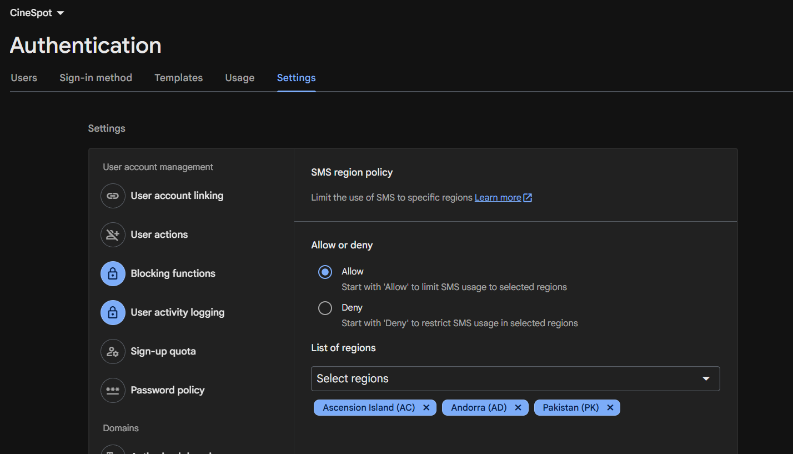
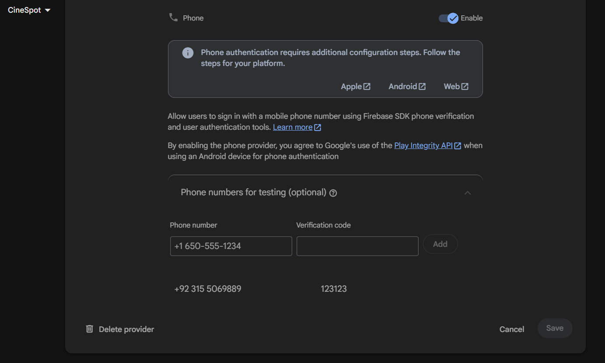
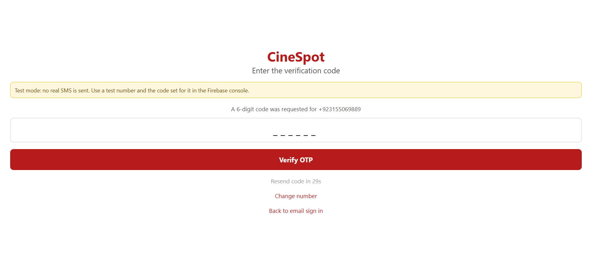
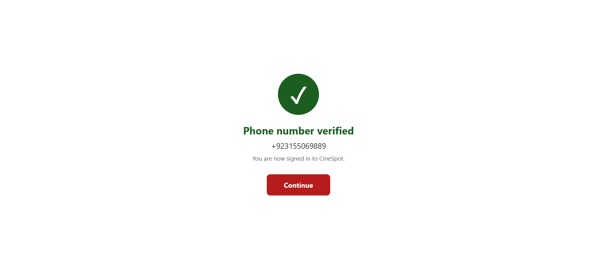

# CineSpot - Movie Booking with Phone OTP Verification

React Native (Expo) app with Firebase Authentication. Users can sign in with email and password, or verify their phone number with a one-time password (OTP).

## Phone OTP flow

1. On the sign-in screen, tap **Sign in with phone number (OTP)**.
2. Enter the phone number with its country code (for example `+1 650 555 3434`). The number is validated before anything is sent.
3. Tap **Send OTP**. Firebase issues a verification request.
4. Enter the 6-digit code and tap **Verify OTP**.
5. On success a **Phone number verified** screen is shown, then the app opens. On failure a clear message is shown (wrong code, expired code, too many attempts, invalid number, no connection) and the user can retry.
6. The code can be resent after a 30-second countdown, and the number can be changed.

Files: `otp.js` (Firebase calls, phone validation, error messages), `screens/PhoneLoginScreen.js` (phone and code steps), `screens/VerifiedScreen.js` (success screen).

## Demo and evidence

**Screen recording of the full flow (send, enter, verify):** [docs/demo/SMD_CineSpot_OTP_verification.mp4](docs/demo/SMD_CineSpot_OTP_verification.mp4)

| 1. SMS region policy | 2. Firebase test number and code |
|---|---|
|  |  |

| 3. OTP requested | 4. OTP entered | 5. Verified |
|---|---|---|
|  |  |  |

The number used is a Firebase fictional test number, so the verification code is the one configured for it in the Firebase console and no real SMS was sent (see the next section).

## Important: test mode (no real SMS)

This build uses **Firebase fictional test phone numbers**. For these numbers Firebase sends **no real SMS**. You enter the code that was set for that number in the Firebase console. The app shows a "Test mode" notice on the phone screen.

Why: sending real SMS from the Firebase JS SDK needs a reCAPTCHA check, which does not run in Expo Go. Real SMS delivery would need a custom development build with React Native Firebase.

`OTP_TEST_MODE` in `otp.js` controls this. Do not ship test mode in a production app.

## Firebase setup (one time)

1. Firebase console, then your project, then **Build > Authentication > Sign-in method**.
2. Enable the **Phone** provider.
3. In the Phone provider settings, open **Phone numbers for testing** and add a number (for example `+1 650-555-3434`) with a 6-digit code (for example `123456`). Up to 10 numbers can be added.
4. Save.
5. Go to **Authentication > Settings > SMS region policy** and allow the country of your test number (for example United States for `+1`). New projects allow no regions by default, and without this Firebase rejects the request with "SMS unable to be sent until this region enabled by the app developer".

## Run

```bash
npm install
npx expo start
```

Scan the QR code with Expo Go (phone and computer on the same Wi-Fi). For the browser preview run `npx expo start --web`.

On Windows PowerShell, if `npx` is blocked, use `npx.cmd expo start`.

## Other features

Movie list, movie details and booking use a stack navigator inside a bottom tab navigator (Movies and Profile). Email and password sign-in and sign-up are still available.
